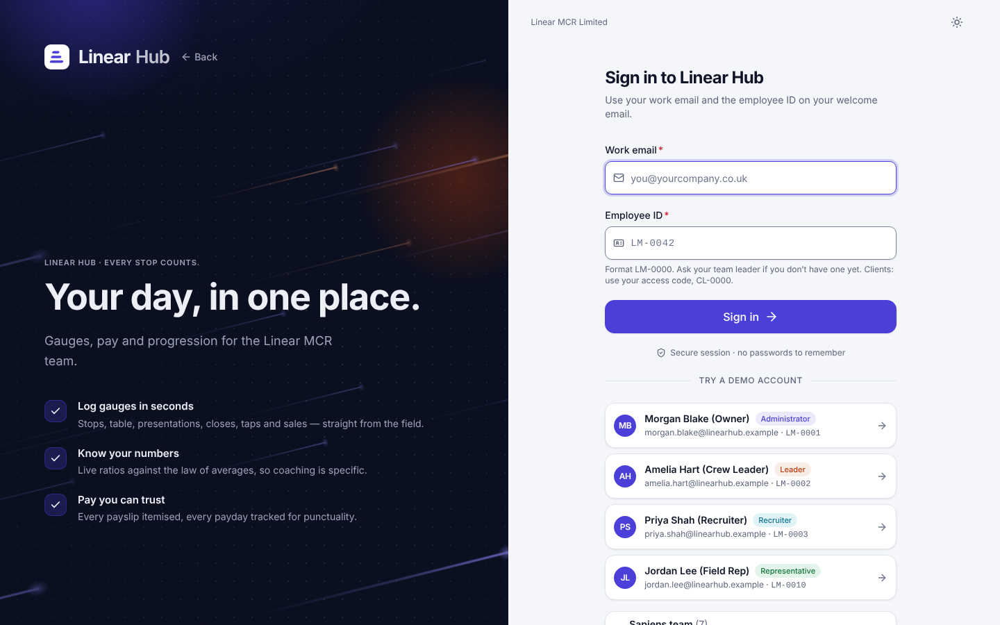
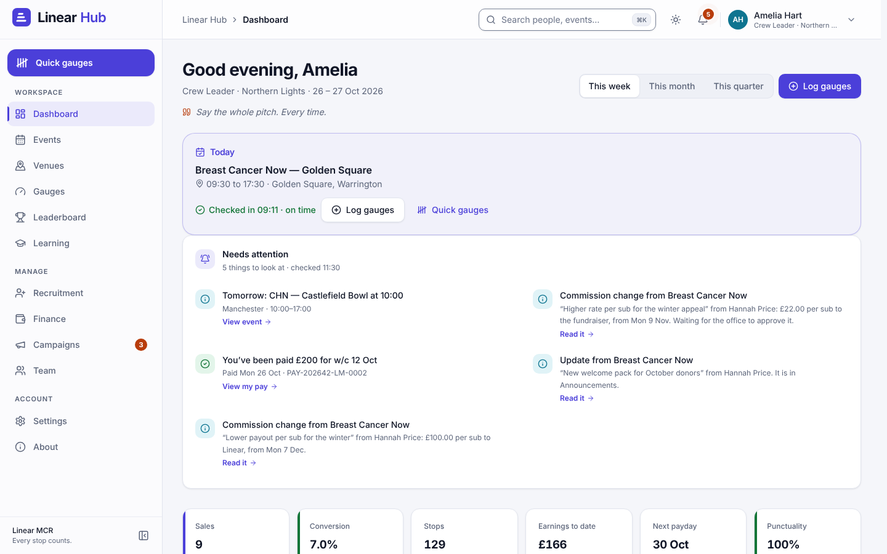
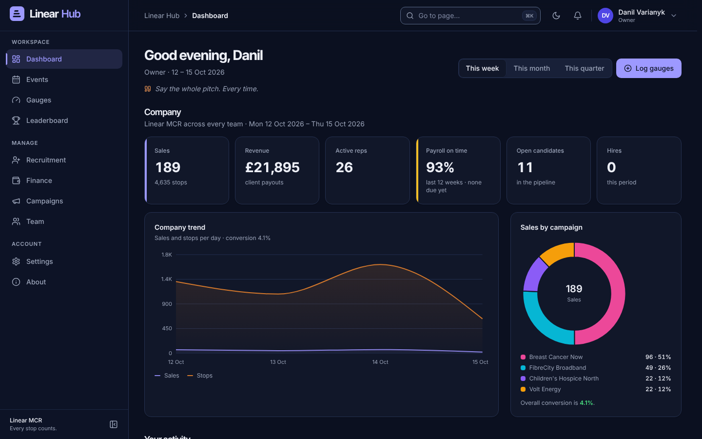
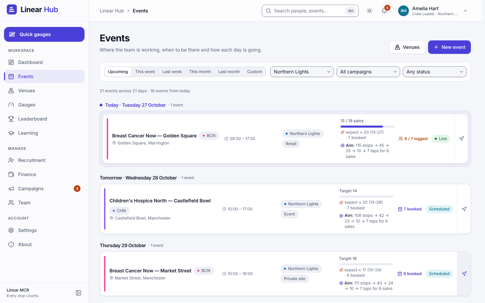
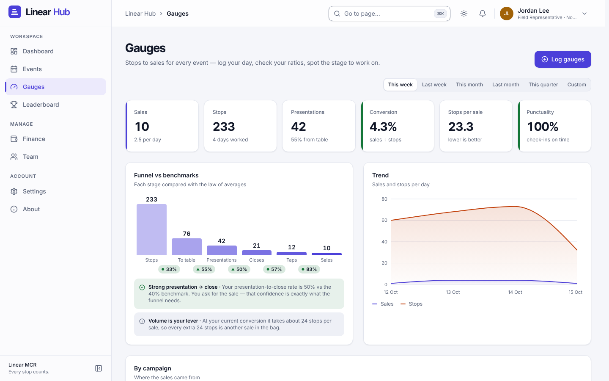
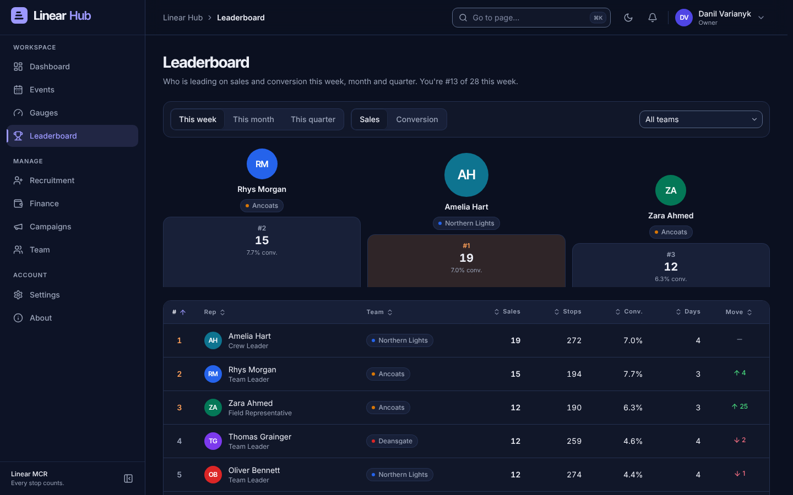
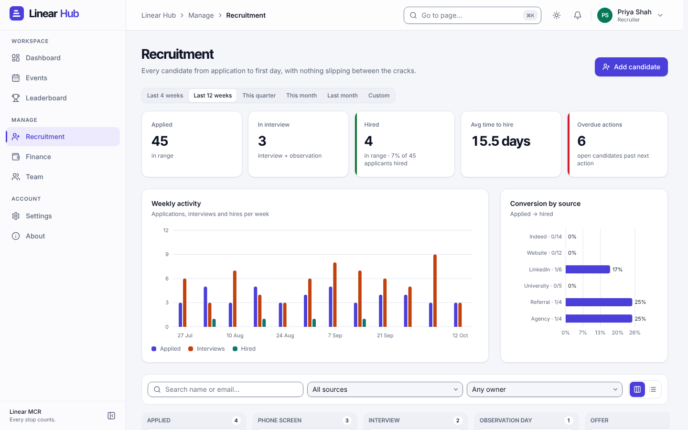
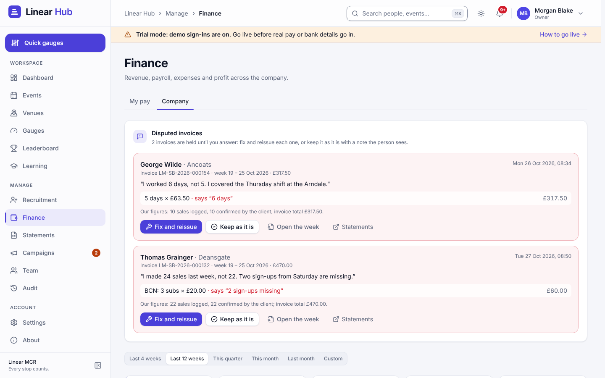
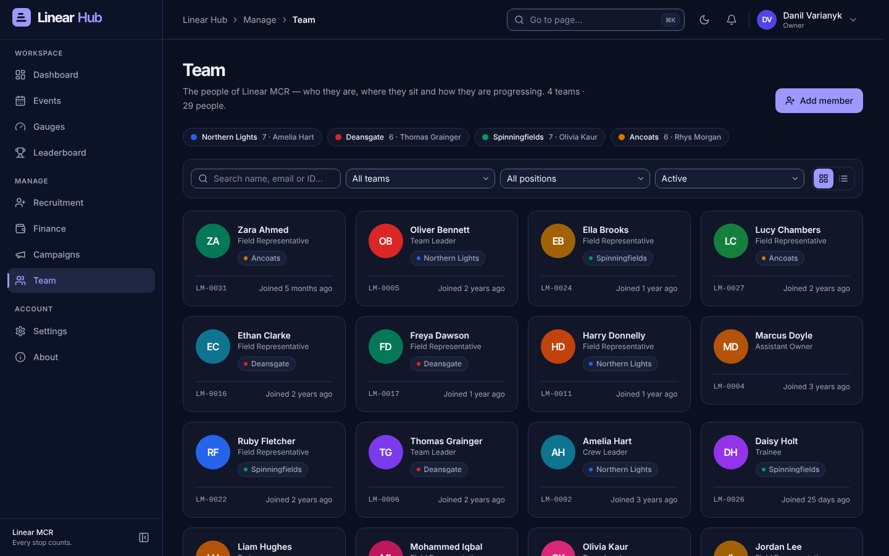

# Linear Hub

**Every stop counts.** The team platform for Linear MCR Limited: every rep sees their own gauges, pay and progression and their team's board; leaders read the whole company and run their own team; the recruiter runs the pipeline; the office sees finance — all behind one sign-in with a work email and employee ID.

> Linear MCR runs face-to-face sales campaigns — B2B, B2C, private-site events and charity fundraising — from Manchester. The six gauges a rep records at every event (stops → to table → presentations → closes → taps → sales) are the heartbeat of the business. Linear Hub is built around them.

---

## Why

Today the business has no CRM, and it shows in small ways every day:

- **Gauges live on paper and in WhatsApp.** Leaders collect six numbers from each rep at the end of each event, retype them, and tally them by hand. Nobody can see a ratio until someone works it out.
- **Coaching starts from a hunch.** Without stage-by-stage ratios against the law of averages, it is hard to say *which* part of the pitch a rep should work on.
- **Recruitment is tracked ad hoc.** Candidates move from applied to observation day to hired in notes and messages; nobody knows the conversion by source or how long a hire takes.
- **Pay and punctuality questions take time to answer.** "What am I being paid this week, and when?" and "Was I paid late?" should be a glance, not a phone call.

Linear Hub fixes those four things without asking the business to change how it works. The gauges are the same six. The benchmarks are the company's own. The pay plan is the one already on the wall.

---

## What it does

| Area | What you get |
|---|---|
| **Dashboard** | Your period at a glance (**This week / This month / This quarter**): sales, stops and conversion with the change against the same days of the previous period; your rank; earnings to date and next payday (red when overdue); punctuality; your trend and funnel with coaching notes; your team's top five; upcoming events; announcements. Leaders and administrators also get a **Company** section; recruiters get a recruitment-first dashboard. |
| **Events & Gauges** | Leaders schedule events for their team against a campaign (venue, date, times, sales target); statuses roll forward by themselves (today's events go **Live** at their start time). Reps **Log gauges** for an event in under a minute: the date is the event's date, the event must be today or earlier and not cancelled, and the funnel rule (each stage ≤ the previous) is checked as you type. Everything rolls up by person, team, campaign, day and week. |
| **Leaderboard** | Everyone who logged sales, ranked by **Sales** or **Conversion** for the week, month or quarter, with movement against the same days of the previous period. Reps see their own team; everyone else can filter by team. |
| **Recruitment** | A board from Applied → Phone screen → Interview → Observation day → Offer → Hired, with interviews, owners, sources, ratings, next actions and overdue flags. Hiring asks for the **Team** and **Position** (Trainee or Field Representative) and creates the rep's account on the spot. |
| **Finance & Pay** | **My pay** for everyone: twelve weeks of itemised payslips (base per day, commission, bonus, leader overrides, deductions) and the next payday. **Team pay** for leaders. **Company** for administrators: revenue, payroll, expenses and profit per pay week, **Runs to pay** with one-click **Mark paid**, payroll punctuality, expenses and margin by campaign. |
| **Team** | The directory: who is on which team, their position on the ladder (Trainee → Field Representative → Team Leader → Crew Leader → Assistant Owner → Owner, plus the office **Recruiter** position), and a performance view per person. |
| **Campaigns** | The clients Linear represents, with sector, type, payout per sale, default rep commission and active/inactive status. |
| **Public page** | Signed-out visitors land on an outward-facing page about Linear MCR and Linear Hub (what we do, the six gauges, the careers ladder) with **Sign in**; staff can review it any time at `/welcome`. The logo and colours come from one config (`client/src/content/brand.ts` and the `--brand-*` block in `client/src/index.css`). |
| **Export & print** | Every table has **Download as CSV** (Excel-ready, exactly the rows on screen, filters in the file name), and each payslip has **Print payslip** for a clean A4 copy. |
| **Smart features** (1.1) | Pace notes, this week's pay estimate, **Check in with…**, the **Needs attention** bell, event forecasts, signal-proof logging, recruitment deadlines and **Your week in review** — see [Smart features](#smart-features-11) below. |
| **Learning** (1.2) | The COD pack as 21 lessons with self-checks, teach-backs your leader signs off, the leadership checklist and the progression tracker; a **pitch studio** per campaign (starting with Breast Cancer Now) with the theory behind each line, a step timer, a teleprompter and flashcards. |
| **Field & office** (1.2) | One-tap **Check in** with a roll call; leader **Bulk entry** (or paste from WhatsApp); an optional sign-in **PIN**; the **Audit** trail and announcement read receipts; ⌘K search for people, events, candidates and campaigns; **Export for payroll** to Xero or Sage. See [What's new in 1.2](docs/USER_GUIDE.md#whats-new-in-12). |

### Roles

| Role | Sees | Can change |
|---|---|---|
| `rep` | Own gauges and pay; own team's events, leaderboard and gauges summary; the directory; any event or profile **read-only** (other people's check-in times and notes are hidden) | Own gauges, at own team's events |
| `leader` | Company-wide reads — every team's events, the full leaderboard, any profile — plus the check-in times and notes of their own team, their own team's payroll, and recruitment | Events for own team; gauges for own team's members at own team's events; candidates, interviews and stage changes; announcements |
| `recruiter` | The whole recruitment pipeline, the directory, own pay; events and the leaderboard read-only | Candidates, interviews, stage changes (hiring creates the rep's account) |
| `admin` | Everything, including every employee ID | Everything — people, campaigns, events, any gauges, payroll payments, expenses, announcements |

**Signing in and security, honestly.** Sign-in is a work email plus an employee ID — there is no password yet, so the employee ID is half of the credential and the API only returns it to administrators and to the person themselves (everyone else sees it blank on the Team page, payslips and profiles). Sessions are httpOnly cookies that last 14 days; after eight failed attempts for the same email in fifteen minutes the login is paused for that window; setting a person's status to **Left** deletes their sessions at once, so they are signed out everywhere. Anyone can turn on optional two-step verification with an authenticator app, and (1.2) a personal sign-in PIN, in **Settings → Security**; an administrator can require a PIN for everyone, require two-step for administrators and set the sign-out time. Single sign-on is on the [roadmap](docs/ROADMAP.md); putting it online is in [docs/DEPLOY.md](docs/DEPLOY.md).

### Smart features (1.1)

Release 1.1 makes the existing screens notice things, using fixed rules over the numbers people can already see — no
outside service, no AI, and the same data always gives the same sentence. Every forecast says **estimate** and shows
its range; pay, pace notes and the check-in list are only ever shown to the person they belong to.

| Feature | Who sees it | Where |
|---|---|---|
| **Your usual pace** and **sales streaks** | reps, leaders, administrators (their own) | dashboard funnel card, **Sales** tile, leaderboard flames |
| **This week (estimate)** of pay, with the distance to the bonus | reps and leaders (their own) | dashboard strip, **Finance → My pay** |
| **Payroll checks** and paying many runs at once | administrators | **Finance → Company → Runs to pay** |
| **Check in with…**, **Team / Company coaching**, **Focus** chips | leaders (own team), the owner (every team) | dashboard, **Gauges → Team** |
| **Needs attention** | everyone, scoped to their role | the bell, pop-up notes, dashboard card |
| **Event forecasts**, suggested targets, **N / M logged** | everyone (forecasts and the **N / M logged** counts); leaders and administrators (targets, and the names of who has not logged) | Events, event page, **New event** |
| **Signal-proof logging** and the **Tally** | anyone who logs gauges | **Log gauges**, an offline strip under the top bar |
| **Quick gauges**: the tally as six big buttons for the field | anyone who logs gauges | top of the sidebar, the topbar on phones, **Full screen** on the Tally card |
| **Recruitment deadlines**, **Idle** badges, **Record the outcome** | recruiters, leaders, the owner | Recruitment, candidate page |
| **Your week in review**, ready for WhatsApp | everyone | bottom of the dashboard (always the last finished week, Monday to Sunday) |

`LM_SMART=0` switches the estimates and suggestions off on the server; the recruitment deadlines, the phone outbox
and the coaching worked out in the browser stay on. Plain-words guide:
[USER_GUIDE.md, "What's new in 1.1"](docs/USER_GUIDE.md#whats-new-in-11); rules and thresholds:
[LOGIC.md §14](docs/LOGIC.md#14-smart-release-11); endpoints and fields:
[API.md, "Smart endpoints"](docs/API.md#smart-endpoints); history: [CHANGELOG.md](CHANGELOG.md).

---

## Screenshots

| | |
|---|---|
|  *Sign in — work email and employee ID, with demo accounts on a demo database* |  *Dashboard — the period at a glance, with coaching from the funnel* |
|  *The same dashboard in the dark theme* |  *Events — today first, then what is coming, then last week under "Earlier"* |
|  *Gauges — ratios tinted against the law of averages* |  *Leaderboard — podium, movement and "You're #N of M"* |
|  *Recruitment — the board from Applied to Hired* |  *Finance — pay runs, Runs to pay and payroll punctuality* |
|  *Team — the directory by team, position and status* | |

---

## Quick start

Requires **Node.js ≥ 22.18** (`.nvmrc` says `22`; 24 and 26 work too). The server runs TypeScript directly with Node's type stripping and uses the built-in `node:sqlite`, so there is nothing else to install.

```bash
npm install
npm run dev
```

- Client: <http://localhost:5173> (Vite dev server; proxies `/api` to the server)
- API: <http://localhost:4000>

The database is created and seeded automatically on first start. Production build on one port:

```bash
npm start      # API + built client on http://localhost:4000
```

`npm start` first installs the dependencies (`npm ci`) if `package-lock.json` changed since the last install, and
rebuilds the screens (`npm run build`) if any client or shared file is newer than the last build, saying which file. So
after a `git pull` the new screens always show. `LM_SKIP_PREPARE=1` skips that step.

### Updating to the latest version

```bash
npm run latest
```

It stops the running copy, pulls, installs and builds what changed, and starts again (or restarts the background
service if you installed one). It never throws away your own edits: if you changed a tracked file it stops and names
it. The one file it does reset is `package-lock.json`, which npm rewrites on install; the pulled version replaces it.
`npm run latest -- --no-start` updates without starting. Do not use `npm update`: that is npm's own command, which
upgrades packages and rewrites the lockfile.

### Scripts

Every command below exists in `package.json` (root) or `server/package.json`.

| Command | What it does |
|---|---|
| `npm run dev` | Server (`node --watch`, `TZ=Europe/London`) and client (Vite) together |
| `npm run build` | Typecheck and build the client into `client/dist` |
| `npm run setup` | Install the dependencies if the lockfile changed (`npm ci`) and rebuild the client if its code changed; `npm start` runs it first |
| `npm start` | Serve the API **and** the built client on <http://localhost:4000> (`NODE_ENV=production`), after `npm run setup` |
| `npm run latest` | Update to the latest version: stop, pull, install, build, start (see Updating to the latest version) |
| `npm run stop` | Stop an earlier copy of Linear Hub that is still holding port 4000 (`PORT=…` for another port). Anything else on the port is reported and left alone |
| `npm run restart` | `npm run stop` followed by `npm start` |
| `npm run share` | While the server runs: the addresses phones and laptops on the same Wi-Fi or hotspot can use, with a QR code to scan |
| `npm run doctor` | Check this machine can run Linear Hub: Node version, built client, data folder, database, port, and a real boot on a temporary database. Run it whenever `npm start` misbehaves |
| `npm run seed` | Delete and rebuild the database with fresh sample data |
| `npm run backup` | Back the database up now (fine while the server runs) into `server/data/backups/` |
| `npm run backups` | List the backup files with size and age |
| `npm run restore -- <file> [--yes]` | Put a backup back as the live database (stop the server first). `<file>` is a path or a file name from the backups folder; it shows what changes and asks first |
| `npm run service:install` | Run Linear Hub in the background and start it at log-in (macOS LaunchAgent, Linux systemd user unit; on Windows it prints the Task Scheduler steps) |
| `npm run service:uninstall` | Remove the background service and free the port |
| `npm run service:status` | Is the service loaded and answering; its last 20 log lines; whether it still points at this Node |
| `npm run service:install -- --print` | Dry run: print the service file and the commands for this machine and change nothing (add `--platform=darwin`, `linux` or `win32` to see another platform's file) |
| `npm run typecheck` | Typecheck `shared`, `server` and `client` |
| `npm test` | Run the shared domain-logic tests and the server route tests (`node:test`) |
| `npm run smoke -w server` | Boot the API on a temporary seeded database and exercise every endpoint against the contract (it pins the business clock to 15:00 on the latest weekday; `SMOKE_REAL_CLOCK=1` uses the real clock) |

### Environment variables

| Variable | Default | Meaning |
|---|---|---|
| `PORT` | `4000` | Port the API (and, in production, the client) listens on |
| `HOST` | unset (every interface) | Set to `127.0.0.1` to make the server reachable from this machine only; unset so phones and laptops on the same network can open it |
| `DB_PATH` | `server/data/linear.sqlite` | Where the SQLite file lives; the directory is created if needed |
| `LM_BACKUP` | on | `0` turns the automatic backups off (`npm run backup` still works) |
| `LM_BACKUP_DIR` | `<data dir>/backups` | Where backups go. Keep it outside the repository (never commit backups) |
| `LM_BACKUP_HOUR` | `2` | London hour (0–23) from which the nightly backup may run |
| `LM_COMPRESSION` | on | `0` turns HTTP compression off (for example behind a reverse proxy that compresses already) |
| `LM_DEMO_ACCOUNTS` | unset | Set to `0` on any deployment with real users: the sign-in page then shows no demo accounts and the API never publishes a login |
| `LM_SMART` | on | `0` switches the 1.1 smart features off: pace notes, pay estimates, payroll checks, check-in lists, the Needs-attention feed, event forecasts, streaks and the week in review answer empty, and the optional fields are left out of existing payloads. Recruitment deadlines stay on (they are workflow rules) |
| `LM_BUSINESS_NOW` | unset (real time) | Pins the business clock — "today" and "now" for events, gauges, pay and the demo seed — to this instant, e.g. `2026-10-19T15:00:00`, for demos and screenshots out of hours (use a fresh `DB_PATH` so the seed is built around it). The clock keeps ticking from there; sessions, rate limits, two-step codes and backups stay on the real clock. The server warns at start-up while it is set. Never set it for real use |
| `LM_APP_SECRET` | unset (generated key file) | Key material for encrypting two-step verification secrets at rest (AES-256-GCM, key = SHA-256 of the value) and for peppering sign-in PINs (HMAC-SHA256 before scrypt). When unset, a random key is generated on first start into `server/data/app-secret` (mode 600, next to the database). Back that file up with the database (the backups folder keeps a copy of it, so keep that folder private), or set the variable to manage the key yourself |
| `LM_APP_SECRET_FILE` | `<data dir>/app-secret` | Where the generated key file lives when `LM_APP_SECRET` is unset |
| `TRUST_PROXY` | unset (off) | Behind a TLS-terminating reverse proxy: `1` (one hop), the proxy's address or CIDR, or a comma list, so `X-Forwarded-Proto` is honoured (Secure cookies, HSTS). Leave unset otherwise |
| `COOKIE_SECURE` | unset | Set to `1` to force the `Secure` flag on the session cookie; it is set automatically when the request arrived over HTTPS (`X-Forwarded-Proto: https`, `trust proxy` is on) |
| `TZ` | `Europe/London` | The business time zone — "today" for events and pay weeks. The npm scripts and the Dockerfile pin it; keep it if you run the server another way |
| `NODE_ENV` | — | `production` makes the server serve `client/dist`; `npm start` sets it |

For troubleshooting and tests only: `LM_DEBUG=1` explains a failed health probe (`npm run stop`, `share`, `doctor`),
`LM_DOCTOR_SKIP_BOOT=1` skips the doctor's boot test, and `SMOKE_REAL_CLOCK=1` runs the smoke test on the real clock.

### Use it from a phone or another laptop (Wi-Fi or hotspot)

The server listens on every network interface, so any device on the same Wi-Fi or hotspot can open it: when it starts
it prints the addresses (`On your network: http://192.168.x.x:4000  http://your-mac.local:4000`), and `npm run share`
in a second terminal prints them again with a QR code to scan. Personal Hotspot works the same way: the phone that
provides the hotspot, and any other device joined to it, can open the printed address. Notes:

- macOS asks once whether `node` may accept incoming connections: click **Allow**. If you clicked Deny, fix it in
  **System Settings → Network → Firewall → Options**, or turn off "Block all incoming connections".
- The IP address changes from network to network; the `.local` name stays the same. Run `npm run share` after
  switching networks.
- Sign-in works over plain `http` on a private network (the session cookie is only marked `Secure` over HTTPS). Do not
  expose the port to the public internet without a reverse proxy and HTTPS.
- `HOST=127.0.0.1 npm start` keeps it private to this machine, for example on public Wi-Fi.

### Run it in the background

So phones on the hotspot keep working with no Terminal window open, and Linear Hub starts by itself when you log in:

```bash
npm run build                # the service serves the built client
npm run service:install      # stops a copy running in a terminal, then installs and starts the service
npm run service:status       # loaded? answering? the last 20 log lines
npm run service:uninstall    # stop it for good and free the port
```

#### macOS: a LaunchAgent

- `npm run service:install` writes `~/Library/LaunchAgents/uk.co.linear-mcr.hub.plist` (label `uk.co.linear-mcr.hub`)
  with `RunAtLoad` and `KeepAlive`: it starts at log-in and macOS restarts it within seconds if it stops. Logs go to
  `~/Library/Logs/LinearHub/linear-hub.log`. It runs this checkout's `server/src/index.ts` with the Node you ran the
  command with (a Homebrew Cellar path becomes the stable `…/opt/node/bin/node` link), in production mode with
  `TZ=Europe/London`, plus `PORT`, `HOST`, `DB_PATH`, `LM_APP_SECRET_FILE`, `LM_BACKUP`, `LM_BACKUP_DIR`,
  `LM_BACKUP_HOUR`, `TRUST_PROXY`, `LM_SMART` and `LM_COMPRESSION` if they are set in that terminal. `LM_APP_SECRET`
  is never written into the file (it would sit there in plain text): use `LM_APP_SECRET_FILE` instead.
- It refuses to install without a built client (`npm run build` first), stops a copy running in a terminal, then loads
  the agent and waits up to 20 seconds for it to answer.
- While it runs as a service, `npm run stop` only makes macOS start it again: use `npm run service:uninstall`
  (for example before `npm run restore`, then `npm run service:install` afterwards).
- After switching Node (`nvm use`, `brew upgrade node`), run `npm run service:install` again; `service:status` and
  `npm run doctor` warn when the service still points at the old Node.
- A sleeping Mac answers nobody: for a day in the field, set System Settings › Battery › Options › "Prevent automatic
  sleeping on power adapter when the display is off".
- **Keep the Linear Hub folder out of Desktop, Documents, Downloads and iCloud Drive.** macOS guards those folders, and
  a background service (unlike Terminal) can be refused access to them ("Operation not permitted" in the log), so it
  could not open the database or write backups. `service:install` and `service:status` warn when the checkout,
  `DB_PATH`, `LM_BACKUP_DIR` or `LM_APP_SECRET_FILE` is in one: move the folder (for example to `~/LinearHub`) and
  install again, or give the Node it names Full Disk Access in System Settings › Privacy & Security. For the same
  reason, do not point `LM_BACKUP_DIR` into iCloud Drive while it runs as a service: copy the folder there by hand
  instead.

#### Linux and Windows

- **Linux**: a systemd user unit, `~/.config/systemd/user/linear-hub.service` (`Restart=always`), started with
  `systemctl --user enable --now`. Run `loginctl enable-linger $USER` to keep it running while nobody is logged in.
- **Windows**: `npm run service:install` prints the Task Scheduler steps; the printed `.cmd` creates
  `%LOCALAPPDATA%\LinearHub` before writing its log there.

`npm run service:install -- --print` shows the file and the commands without changing anything. The files it prints
for macOS, Linux and Windows are covered by the server tests (`server/src/test/service.test.ts`).

#### Release checks on the owner's Mac

macOS cannot run in CI, so these stay as release checks for the owner (only the `--print` plist has been checked: it
parses, `KeepAlive` and `RunAtLoad` are true, and the environment and log path are as above):

1. From a checkout outside Desktop/Documents/Downloads/iCloud: `npm run build && npm run service:install`, then
   `launchctl list | grep uk.co.linear-mcr.hub` and `curl http://localhost:4000/api/health`.
2. `kill -9 <pid>` (the pid from `npm run service:status`): a new pid answers within 10 seconds.
3. `npm run service:uninstall`: port 4000 is free (`lsof -iTCP:4000 -sTCP:LISTEN` prints nothing).
4. `npm run backup && npm run backups`; delete a gauge, `npm run service:uninstall`, `npm run restore -- <file> --yes`,
   `npm run service:install`: the gauge is back.

### Troubleshooting

| Symptom | What to do |
|---|---|
| `npm start` says port 4000 is already in use, or an older build printed "listening" and the shell prompt came straight back | An earlier copy of this server is still running (another terminal tab or window; older builds printed "listening" anyway because Express 5 hands a failed bind to the listen callback instead of throwing). Run `npm run stop`, then `npm start`. The server now refuses to start behind another process, names it and exits with code 1, and reports any other reason it stops (a signal, a crash, a drained event loop). `npm run doctor` checks everything else; paste its report when asking for help |
| The browser shows a blank page that never finishes loading on <http://localhost:4000> | Something else is answering on that port. If it is an old Linear Hub, `npm run stop` ends it; otherwise find it with `lsof -nP -iTCP:4000 -sTCP:LISTEN` and `kill <PID>`, or use `PORT=4001 npm start` |
| An old copy keeps appearing on port 4000 | Stop the server with **Ctrl+C** in the terminal where it runs, not Ctrl+Z (which only pauses it and keeps the port) and not by closing the window. The current build stops within two seconds of Ctrl+C and treats Ctrl+Z as a stop request; an older copy that is still around is ended by `npm run stop` |
| A phone on the same Wi-Fi or hotspot cannot open the address | Allow incoming connections for `node` in **System Settings → Network → Firewall**, check both devices are on the same network, re-run `npm run share` for the current address, and make sure `HOST` is not set |
| `Cannot find module 'qrcode'` or similar after a `git pull` | Dependencies changed. `npm start` now installs them first; with an older checkout run `npm ci`, then `npm start` |
| New features do not appear after updating | Either the pull did not happen or the screens were not rebuilt. Use `npm run latest`, which does both. `npm start` also rebuilds stale screens, and the server warns at start-up when they are out of date. `curl -s localhost:4000/api/health` shows the running version |
| `git pull` says "Your local changes to package-lock.json would be overwritten" | npm rewrote that file during an install. It is generated, so discard it: `git restore package-lock.json`, then `git pull` (or just `npm run latest`, which does this for you). Installs now use `npm ci`, which never rewrites it |
| `npm start` serves the API but the page is empty or stale | Rebuild the client: `npm run build` (the server serves `client/dist`) |
| "Too many wrong PINs. Try again after …" and nobody else can reset that PIN (the only administrator), or no PIN works after the `app-secret` file or `LM_APP_SECRET` was lost | Wait for the time shown, or on the computer that runs Linear Hub: `npm run pin:reset -- danil@linear-mcr.co.uk` (their sign-in email; set `DB_PATH` as you do for `npm start`). It clears that person's PIN and lock and signs them out everywhere; they sign in with their email and employee ID and set a new PIN |

### Backups and restore

Everything — people, gauges, pay — is in one file, `server/data/linear.sqlite`. While the server runs it keeps dated
copies of it in **`server/data/backups/`** (set `LM_BACKUP_DIR` to put them elsewhere):

- **10 minutes after start-up**, when the last backup is more than 24 hours old;
- **every night**: an hourly check backs up once the London time has reached 02:00 (`LM_BACKUP_HOUR`) and there is no
  backup dated today. A laptop that was asleep at 02:00 gets its copy within an hour of waking.

Each copy is a complete, checked database (`linear-2026-10-19-0200.sqlite`, named in London time), made with SQLite's
online backup, so it is consistent even while people are logging gauges. The folder keeps the newest copy of each of
the last 30 days plus one a week for the 8 weeks before that; older copies are deleted (never one made in the last 24
hours), anything else in the folder is left alone. `LM_BACKUP=0` turns the automatic schedule off (`npm run backup`
still works). Backups always run on the real clock, even when `LM_BUSINESS_NOW` pins the business day.

```bash
npm run backup                       # back up now (works while the server is running)
npm run backups                      # list the copies with size and age
npm run stop                         # a restore needs the server stopped
npm run restore -- linear-2026-10-19-0200.sqlite        # shows what changes and asks before replacing
npm start
```

`restore` refuses while the database is open in another process — a Linear Hub started with another `PORT` or
`HOST`, or a background service, is caught too, because it checks the file's lock rather than only the port ("The
database is open in another process … Stop it first, with the PORT it runs on") — and while anything answers on the
port ("Stop it first: npm run stop"). It checks the backup
(`PRAGMA integrity_check` and the Linear Hub tables), prints the current and the backup's users, gauge entries,
payroll runs and latest gauge date side by side, and only then asks (`--yes` skips the question). The database it
replaces is kept next to it as `linear.sqlite.before-restore-<date-time>`, so a restore can itself be undone. If
Linear Hub runs as a background service, stop it with `npm run service:uninstall` instead of `npm run stop` (macOS
would only start it again), restore, then `npm run service:install`.

**Keep the folder private and copy it off the laptop.** It holds everyone's names and pay. It also holds
`app-secret`, a copy of the key that encrypts two-step sign-in secrets and is mixed into every sign-in PIN (mode 600):
without it, after restoring on a new laptop people with two-step sign-in could not finish signing in and no PIN would
match (restore puts it in place when the new laptop has none, and warns when there is no key anywhere or a different
one). Because the key travels with the database copies, anyone with the whole folder could try every 4-digit PIN in
minutes, so treat the folder like the key: only in your own account, never in a shared folder or sent to anyone. A
backup on the same laptop does not survive losing the laptop: copy the folder to your own iCloud Drive or Google Drive
now and then. `npm run doctor` warns when the last backup is more than 36 hours old and
when the disk has less than 1 GB free; **Settings › Backups** shows the same to the owner.

**Never commit the backups folder.** `server/data/backups/`, the `*.before-restore-*` copies a restore keeps and its
`*.restoring-*` staging files are in `.gitignore`, as are the live database (`server/data/*.sqlite`) and
`server/data/app-secret`; if you set `LM_BACKUP_DIR`, choose a folder outside the repository (never push a copy of
payroll and the sign-in key to GitHub). Before any `git add`, `git status` should show nothing under `server/data/`.

### Docker

```bash
docker build -t linear-hub .
docker run -p 4000:4000 -v linear-data:/app/server/data linear-hub
```

The image builds the client, installs production dependencies only, sets `TZ=Europe/London`, exposes port 4000 and keeps the database in the `/app/server/data` volume. Add `-e LM_DEMO_ACCOUNTS=0` when the database holds real people.

### Demo accounts

Sign in with the email and employee ID (matching is case-insensitive). On a freshly seeded database the sign-in page also has one-click buttons for these four.

| Role | Name | Email | Employee ID |
|---|---|---|---|
| admin | Danil Varianyk (Owner) | danil@linear-mcr.co.uk | LM-0001 |
| leader | Amelia Hart (Crew Leader) | amelia.hart@linear-mcr.co.uk | LM-0002 |
| recruiter | Priya Shah (Recruiter) | priya.shah@linear-mcr.co.uk | LM-0003 |
| rep | Jordan Lee (Field Rep) | jordan.lee@linear-mcr.co.uk | LM-0010 |

Sample teams: Northern Lights, Deansgate, Spinningfields, Ancoats. Sample campaigns: Breast Cancer Now (fundraising, private sites), Children's Hospice North (fundraising, events), Volt Energy (B2B), FibreCity Broadband (residential).

---

## Architecture

Three npm workspaces in one repository, all TypeScript (strict, ESM):

- **`client`** — React 19, Vite 6, Tailwind CSS v4 (semantic design tokens, light and dark themes), TanStack Query 5, React Router 7, Recharts, lucide-react. Pages compose domain components from `src/features/**`, the UI kit from `src/components/ui`, and charts from `src/components/charts`.
- **`server`** — Express 5 with SQLite through `node:sqlite` (no native build step), Zod validation, httpOnly session cookie, role rules and employee-ID redaction in `src/lib/scope.ts`, pay rules in `src/lib/pay.ts`. Seeds deterministic sample data on first run, materialises weekly payroll runs and rolls event statuses forward (`src/db/maintenance.ts`), and serves the built client in production.
- **`shared`** — `@lm/shared`: the domain types, brand constants, benchmark ratios and pure business logic (funnel ratios and validation, payroll calculation, paydays, punctuality, ranking, coaching insights) used by both sides so the numbers always agree.

The API contract is in [`docs/API.md`](docs/API.md). Design tokens and the UI kit are described in [`docs/DESIGN.md`](docs/DESIGN.md); the maths behind ratios, payroll and charts in [`docs/LOGIC.md`](docs/LOGIC.md).

```
linear-micro-crm/
├── client/                          # React 19 + Vite 6 + Tailwind v4 (dev on :5173)
│   ├── index.html
│   ├── public/                      # favicon, logo
│   └── src/
│       ├── api/                     # fetch wrapper (client.ts) + TanStack Query hooks (hooks.ts)
│       ├── auth/                    # AuthProvider, RequireAuth, RequireRole
│       ├── components/
│       │   ├── brand/               # Logo
│       │   ├── charts/              # Funnel, Trend, Bars, Donut, Sparkline (Recharts)
│       │   ├── layout/              # AppShell, Sidebar, Topbar, nav.ts, theme
│       │   └── ui/                  # Button, Card, Badge, DataTable, Modal, Tabs, Stepper, …
│       ├── content/                 # copy.ts, about.ts, team.ts — all microcopy
│       ├── features/                # the bulk of the UI, by domain
│       │   ├── campaigns/           #   campaign form
│       │   ├── common/              #   range picker, status badges, confirm dialog, loading/error states, ErrorBoundary, offline banner
│       │   ├── dashboard/           #   announcements, company section, recruiter section, upcoming events
│       │   ├── events/              #   event form, event row, forecast chip
│       │   ├── finance/             #   payroll runs table, payslip, add expense, bulk Mark paid
│       │   ├── gauges/              #   Log gauges modal, outbox, tally, summary and entries tables, performance panel, coaching
│       │   ├── recruitment/         #   candidate card, "Move to…" control, schedule interview, stage stepper, Record the outcome
│       │   ├── settings/            #   two-step verification set-up and recovery codes
│       │   ├── smart/               #   1.1 dashboard slots: Needs attention, pace note, pay strip, check-ins, week in review (lazy.tsx)
│       │   └── team/                #   user form
│       ├── lib/                     # formatGBP, dates, labels, ratios
│       └── pages/                   # one file per route
├── server/                          # Express 5 + node:sqlite (:4000)
│   ├── data/                        # linear.sqlite (generated, git-ignored)
│   └── src/
│       ├── app.ts                   # Express app factory (routes, static client in production)
│       ├── index.ts                 # bootstrap: open DB, seed, maintenance timers, listen
│       ├── db/                      # connection, schema, seed, seed-data, queries
│       │   └── maintenance.ts       # payroll materialisation, event status roll-forward
│       ├── lib/                     # dates (business clock), pay rules, metrics, scope (role rules + redaction), validation,
│       │   │                        #   errors, response cache, compression, backups, two-step verification
│       │   └── smart/               # 1.1 builders (pace, streaks, pay forecast, payroll checks, check-ins, event forecasts,
│       │                            #   digest) behind the LM_SMART switch
│       ├── middleware/              # session authentication
│       ├── routes/                  # one file per API area (incl. insights, attention, digest)
│       ├── test/                    # server route tests (node:test, npm test)
│       ├── backup.ts · restore.ts   # npm run backup / backups / restore
│       ├── service.ts               # npm run service:install / uninstall / status
│       ├── doctor.ts · stop.ts · share.ts   # npm run doctor / stop / share
│       └── smoke.ts                 # boots a temporary DB and exercises every endpoint
├── shared/                          # @lm/shared — types, constants, pure logic (+ node:test suites)
│   └── src/
│       ├── types.ts
│       ├── constants.ts
│       └── logic/
├── docs/                            # API, LOGIC, DESIGN, TEAM_CONTRACT, TEAM, PITCH, USER_GUIDE, ROADMAP, LOAD_TEST, screenshots/
├── CHANGELOG.md
├── Dockerfile
└── package.json                     # npm workspaces + root scripts
```

---

## Documentation

- [`docs/USER_GUIDE.md`](docs/USER_GUIDE.md) — step-by-step for reps, leaders, recruiters and administrators, using the app's own button and tab names
- [`docs/PITCH.md`](docs/PITCH.md) — the business case and rollout plan for Linear MCR
- [`docs/ROADMAP.md`](docs/ROADMAP.md) — what comes next
- [`docs/DEPLOY.md`](docs/DEPLOY.md) — putting Linear Hub online (HTTPS, backups off the server, a go-live checklist)
- [`CHANGELOG.md`](CHANGELOG.md) — what changed in each release (1.2.0: learning, field and office; 1.1.0: the smart release)
- [`docs/API.md`](docs/API.md) — the API contract and implementation notes
- [`docs/LOGIC.md`](docs/LOGIC.md) and [`docs/DESIGN.md`](docs/DESIGN.md) — the maths (section 14: the smart release, backups and what loads when; section 15: release 1.2) and the design system
- [`docs/LOAD_TEST.md`](docs/LOAD_TEST.md) — the load and robustness report (§10: 1.1 against 1.0 on the same machine)
- [`docs/TEAM.md`](docs/TEAM.md) and [`docs/TEAM_CONTRACT.md`](docs/TEAM_CONTRACT.md) — who built it and how

---

## Built by

A five-person squad, each owning one slice of the codebase, merged by an integrator (see [`docs/TEAM.md`](docs/TEAM.md)):

| Name | Role | Slice |
|---|---|---|
| **Tomasz Nowak** | Backend Developer | API, database and maintenance, seed data, auth, role rules and redaction, pay rules |
| **Aisha Rahman** | Frontend Developer | Pages, feature components, data hooks, routing, auth flow |
| **Callum Reid** | Product Designer (Brand & UI) | Design tokens, themes, UI kit, app shell, sign-in |
| **Mei-Ling Chen** | Logic Builder (Data & Charts) | Funnel and payroll logic, benchmarks, coaching insights, charts |
| **Sophie Whitfield** | Marketing & Content | Product story, microcopy, user guide, pitch, About page |

---

## A note on the data

All sample data is **illustrative**. People, candidates, events, gauges, pay runs and expenses are generated deterministically for the last 26 weeks — but anchored to the date the seed runs, so a fresh install always looks like "this week" and every chart has something to show. Regenerate it with `npm run seed`; the figures will differ from an earlier run only because the calendar has moved. The demo names are not real employees, and the figures are not Linear MCR's actual results. Facts about the company itself (what it does, where it is registered, how its ladder works) come from public sources.

---

© Linear MCR Limited — internal use.
